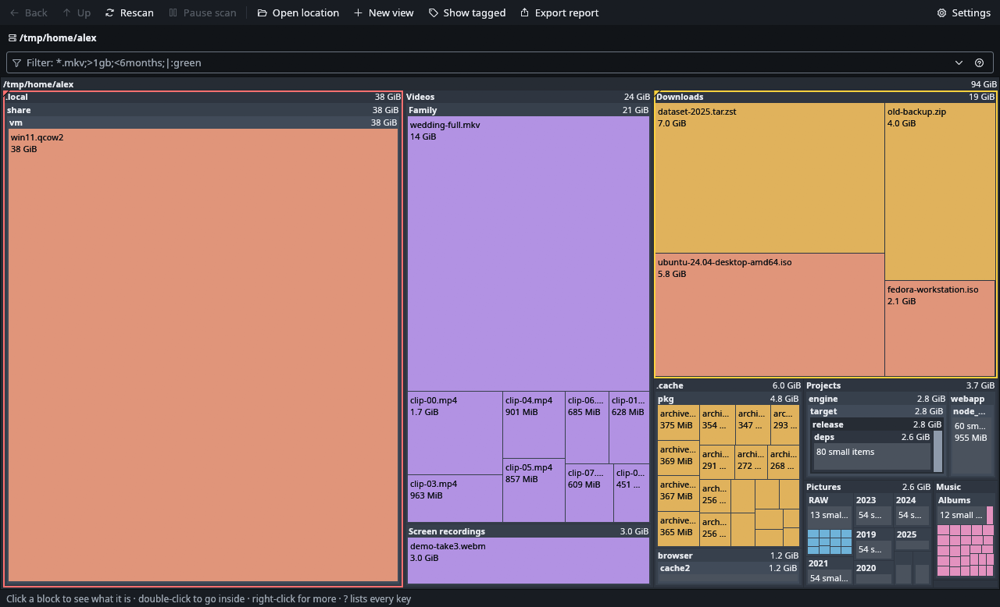

# Acreage

See what's taking up your disk. A live map of every folder and file, labelled and to scale, that keeps up as things change. For Linux.



- **Live.** Blocks appear while the scan runs and update when files change on disk.
- **Sizes that match `du`.** Hardlinks counted once, btrfs subvolumes included, sparse files flagged.
- **Keyboard all the way.** hjkl/arrows, Enter, Backspace, `/` to filter, Shift+F10 for the menu, `?` for every key. Tiles cleanly in i3 and Sway.
- **Filters** like `*.iso;>1gb;<6months;|:green`, tags, several views, Trash with confirm, reports in text/CSV/JSON.

## Install

AUR and Flathub packages are coming. Until then, pick one of these.

### Ready-made binary (x86_64, glibc 2.35 or newer)

Download from the [latest release](https://github.com/Nikoly3210/acreage/releases/latest), check it and install for your user:

```
curl -LO https://github.com/Nikoly3210/acreage/releases/download/v0.1.0/acreage-0.1.0-x86_64-linux.tar.gz
curl -LO https://github.com/Nikoly3210/acreage/releases/download/v0.1.0/acreage-0.1.0-x86_64-linux.tar.gz.sha256
sha256sum -c acreage-0.1.0-x86_64-linux.tar.gz.sha256
tar xzf acreage-0.1.0-x86_64-linux.tar.gz
cd acreage-0.1.0-x86_64-linux
install -Dm755 acreage ~/.local/bin/acreage
install -Dm644 acreage.desktop ~/.local/share/applications/acreage.desktop
for d in icons/*/; do install -Dm644 "$d/acreage.png" ~/.local/share/icons/hicolor/"$(basename "$d")"/apps/acreage.png; done
```

`~/.local/bin` must be on your `PATH`. It needs libxkbcommon (with its X11 part), fontconfig and OpenGL, which desktop systems already have; on a minimal Debian or Ubuntu install add `libxkbcommon-x11-0 libfontconfig1 libgl1`. To remove it, delete the same files.

### Arch Linux: build the package yourself

The PKGBUILDs that will go to the AUR are in this repository. `makepkg` builds a normal package that pacman tracks and can remove:

```
git clone https://github.com/Nikoly3210/acreage acreage
cd acreage/packaging/aur/acreage        # the v0.1.0 release; acreage-git builds the latest commit
makepkg -si
```

### From source (recent stable Rust; developed with 1.99)

```
git clone https://github.com/Nikoly3210/acreage acreage
cd acreage
cargo build --release
./target/release/acreage ~
```

## Use

```
acreage [PATH]                 open the map (no PATH: pick a disk)
acreage PATH --report - [--depth N] [--files] [--format text|csv|json]
                               print a report without opening a window
  --apparent-size              file length instead of space on disk
  --cross-fs                   also go into other filesystems below PATH
  -f, --filter EXPR            start with a filter
  --theme dark|light
```

Settings live in `~/.config/acreage/config.toml`. Press `?` in the app for every shortcut.

## Privacy

No account, no telemetry, no network requests. Nothing leaves your machine.

## Problems

Open an issue at https://github.com/Nikoly3210/acreage/issues with your distro, display server (X11/Wayland) and the output of `acreage --version`.

## Development

```
cargo test                                         # unit + scanner tests
cargo build --release && python3 -m unittest discover -s e2e -v   # end-to-end, needs Xvfb and xdotool
cargo run --example gallery                        # design system gallery
```

## Support

Acreage is free and stays free. If it saved you an afternoon, you can [buy me a coffee](https://buymeacoffee.com/nikoly3210).

## Licence

GPL-3.0-or-later. See [LICENSE](LICENSE).
